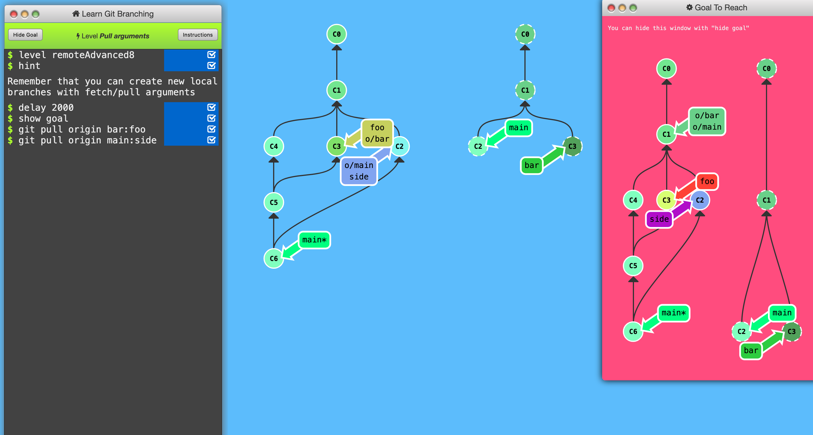
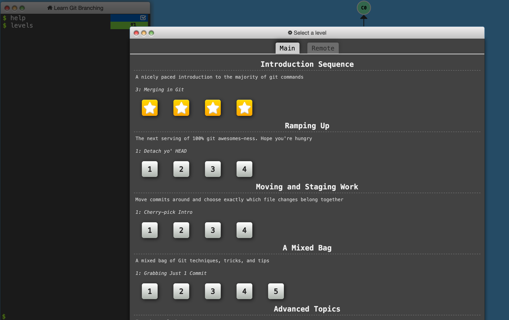

# HW3-Julian

# Git Tutorial Screenshots

    
    
    ![Screenshot 3](images/screenshot3.png
    
I tried for a long time to get the 16th one on Remote, but that screenshot was the 
closest solution I could find.
